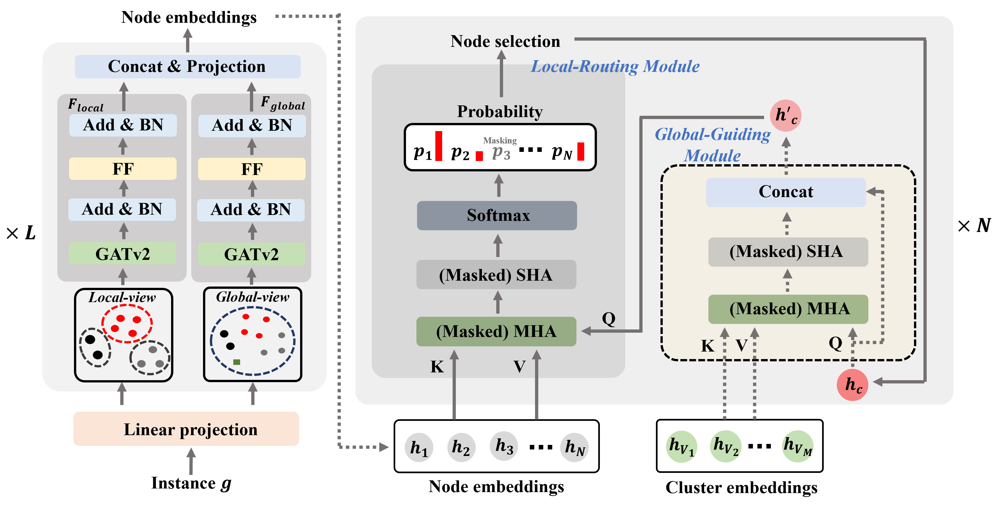

<h1 align="center">
A Multi-View Attention-Based Encoder-Decoder Framework for Clustered Traveling Salesman Problem
</h1>

<p align="center">
  <a href="https://www.python.org/"></a>
  <a href="https://pytorch.org/"></a>
  <a href="https://pytorch-geometric.readthedocs.io/"></a>
  <a href="https://ieeexplore.ieee.org/document/11248888/"></a>
</p>

>This repository is the official implementation of our paper, "**A Multi-View Attention-Based Encoder-Decoder Framework for Clustered Traveling Salesman Problem**", IEEE Robotics and Automation Letters (IEEE RA-L), vol.11, no.1, pp.137-144, 2026.
>Our code is partially based on the [POMO](https://github.com/yd-kwon/POMO) repository.

<p align="center">
  
</p>

## Abstract

Many autonomous mobile robot path planning scenarios require servicing grouped delivery points. Such clustered routing problems are naturally formulated as the clustered traveling salesman problem (CluTSP), which comprises two interdependent subproblems: global inter-cluster routing to determine the order of cluster visits and local intra-cluster routing to optimize paths within each cluster.
Existing approaches often solve these subproblems separately, which leads to suboptimal solutions due to limited information sharing between global and local decisions and requires long computation times. To address these limitations, we propose a unified deep reinforcement learning framework to obtain a powerful and flexible CluTSP routing agent based on a novel multi-view attention-based encoder-decoder framework.
Our graph neural network-based dual encoder structure effectively captures both global and local routing contexts, and the collaborative decoder generates the overall robot trajectory from a global perspective. Our novel and efficient architecture enables solving both subproblems via unified one-shot construction without addressing each problem separately. 
Extensive experiments demonstrate that our approach significantly outperforms existing decomposition-based and learning-based methods.

## Quick Start

### ⚙️ **Requirements**
- `Python=3.10.14`
- `torch==2.2.2`
- `torch_geometric==2.5.2`
- `numpy==1.24.3`
- `pytz==2024.1`
- `sklearn==1.4.2`

---

### 🏃 **Train**

- Run `train.py`. The current code uses the same hyperparameter settings as those described in the paper.

---

### 🏃‍♂️ **Test**

- Run `test.py`. You can modify the `n_node` (number of nodes) and `n_cluster`(number of clusters) parameters to evaluate the model on various datasets. It's set to use the our main model in the result folder, but you can easily switch to a model you've trained.

---
📝 If you find our code valuable for your research, please cite:
```bibtex
@ARTICLE{11248888,
  author={Park, Jimin and Choi, Inguk and Kim, Hyun-Jung},
  journal={IEEE Robotics and Automation Letters},
  title={A Multi-View Attention-Based Encoder-Decoder Framework for Clustered Traveling Salesman Problem},
  year={2026},
  volume={11},
  number={1},
  pages={137--144},
  doi={10.1109/LRA.2025.3632724}
}
```
